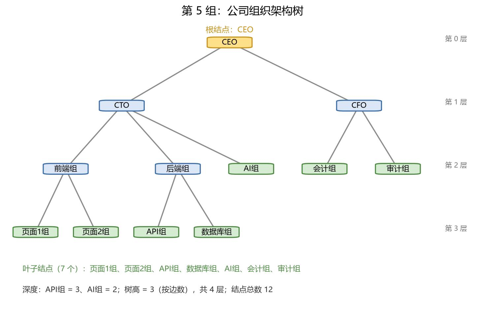
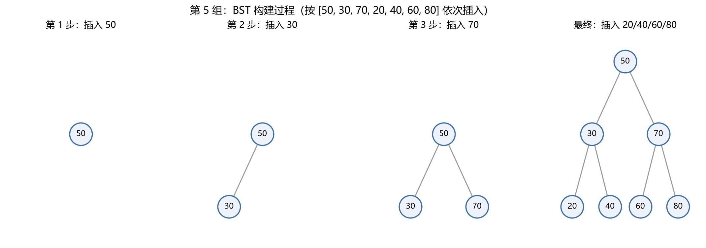

# W11 树及其遍历作业（第 5 组）

> 研讨课一：`tree_workshop.py`（组织架构树 + 三种递归遍历）
> 研讨课二：`bst_project.py`（项目 A：BST 构建与查找）
> 运行环境：Python 3.12 / Windows 11，无第三方依赖

## 1. 组别与分工

| 组别 | 5 |
|:---|:---|
| 成员 | 姜来、仝仲恒、曹智鑫、熊奥华、刘京、陆奕冰 |

## 2. 研讨课一 · 任务 1：公司组织架构树（代码）

`tree_workshop.py` 里用「孩子列表」建模，没有左右之分：

```python
class TreeNode:
    def __init__(self, val):
        self.val = val
        self.children = []
```

建树：

```python
ceo = TreeNode("CEO")
cto, cfo = TreeNode("CTO"), TreeNode("CFO")
ceo.children = [cto, cfo]

fe, be, ai = TreeNode("前端组"), TreeNode("后端组"), TreeNode("AI组")
cto.children = [fe, be, ai]
fe.children = [TreeNode("页面1组"), TreeNode("页面2组")]
be.children = [TreeNode("API组"), TreeNode("数据库组")]
cfo.children = [TreeNode("会计组"), TreeNode("审计组")]
```

程序打印出来的树：

```text
CEO
├── CTO
│   ├── 前端组
│   │   ├── 页面1组
│   │   └── 页面2组
│   ├── 后端组
│   │   ├── API组
│   │   └── 数据库组
│   └── AI组
└── CFO
    ├── 会计组
    └── 审计组
```

结构与课件背景完全一致。`depth_of()` 用 BFS 求深度，`height()` 用递归求高度，`leaves()` 用递归收集叶子：

| 量 | 结果 |
|:---|:---|
| 根结点 | CEO |
| 叶子结点（7 个） | 页面1组、页面2组、API组、数据库组、AI组、会计组、审计组 |
| 结点总数 | 12 |
| API组 深度 | 3（CEO 算 0 层） |
| AI组 深度 | 2 |
| 树高 | 3（按边数）；4（按层数，含 CEO 那一层） |

> 深度和高度都从 0 起算：`depth_of(ceo, "CEO") == 0`，叶子结点 `height(...) == 0`。课件里若按「层数」数，就是上表括号里的值。

## 3. 组织架构树图



图中标了根结点、叶子结点（绿色）以及每一层的层号：CEO 是根，CTO / CFO 在第 1 层，前端组 / 后端组 / AI组 / 会计组 / 审计组 在第 2 层，页面1组 / 页面2组 / API组 / 数据库组 在第 3 层。

## 4. 一个遍历口诀（三种遍历的访问顺序）

**前序根左右，中序左根右，后序左右根；层序按层从上到下、从左到右。**

对应到代码里只有一行之差——访问自己的 `out.append(node.val)` 放在哪儿：

| 遍历 | 代码顺序 | 口诀 |
|:---|:---|:---|
| 前序 `preorder` | 访问 → 左 → 右 | 根左右 |
| 中序 `inorder` | 左 → 访问 → 右 | 左根右 |
| 后序 `postorder` | 左 → 右 → 访问 | 左右根 |
| 层序 `level_order` | 用队列 BFS | 一层一层来 |

### 4.1 手算结果与程序对照（任务 2 那棵树）

```text
      10
     /  \
    5    15
   / \   / \
  3   7 12  20
```

| 遍历 | 手算 | 程序输出 | 一致 |
|:---|:---|:---|:---|
| 前序 | 10 5 3 7 15 12 20 | 10 5 3 7 15 12 20 | ✔ |
| 中序 | 3 5 7 10 12 15 20 | 3 5 7 10 12 15 20 | ✔ |
| 后序 | 3 7 5 12 20 15 10 | 3 7 5 12 20 15 10 | ✔ |
| 层序 | 10 5 15 3 7 12 20 | 10 5 15 3 7 12 20 | ✔ |

中序结果是 `3 5 7 10 12 15 20`，严格升序 → **这棵树是 BST**（BST 的中序遍历必然有序，这也是后面验证 BST 的标准手段）。

### 4.2 Base Case 的重要性（空树 / 单结点）

| 输入 | 前序 | 中序 | 后序 | 结点数 | 叶子数 |
|:---|:---|:---|:---|:---|:---|
| 空树 `None` | `[]` | `[]` | `[]` | 0 | 0 |
| 单结点 `BinNode(1)` | `[1]` | `[1]` | `[1]` | 1 | 1 |

三个遍历函数第一行都是 `if not node: return out`——少了它，空树会直接 `AttributeError: 'NoneType' object has no attribute 'left'`，单结点的左右孩子又会被当成结点去访问。

## 5. 研讨课二 · 项目 A：BST 构建与查找

> 项目 A、B 二选一，本组选 **A（构建与查找）**：插入规则 + 查找路径能完整对应「BST 就是二分查找的树形版」，而删除要讨论后继结点，篇幅会翻倍。

### 5.1 按 `[50, 30, 70, 20, 40, 60, 80]` 依次插入

程序逐步打印的形状（前 3 步 + 最终）：

```text
-- 第 1 次插入 50 --
50

-- 第 2 次插入 30 --
50
├── 30

-- 第 3 次插入 70 --
50
├── 30
└── 70
```

```text
-- 第 7 次插入 80（最终树）--
50
├── 30
│   ├── 20
│   └── 40
└── 70
    ├── 60
    └── 80
```

最终树：根 50，左子树 `30(20, 40)`，右子树 `70(60, 80)`；共 7 个结点，高度 3。

### 5.2 查找函数

```python
def search(root, val, path=None):
    if path is None:
        path = []
    if not root:
        return None, path          # Base Case：走到空结点，说明没有
    path.append(root.val)
    if val == root.val:
        return root, path          # 找到了
    if val < root.val:
        return search(root.left, val, path)    # 比根小 → 去左边
    return search(root.right, val, path)       # 比根大 → 去右边
```

### 5.3 查找路径（实测）

| 查找值 | 路径 | 结果 | 比较次数 |
|:---|:---|:---|:---|
| 40 | 50 → 30 → 40 | ✔ 找到 | 3 |
| 65 | 50 → 70 → 60 → None | ✘ 没找到（65 落在 60 和 70 之间的空档） | 3 |
| 80 | 50 → 70 → 80 | ✔ 找到 | 3 |

### 5.4 中序遍历验证有序

```text
中序遍历：20 30 40 50 60 70 80
中序升序：True；is_bst()：True
```

`is_bst()` 额外用「区间夹逼」检查（左子树全部 < 根 < 右子树全部），确认结构本身合法，而不只是中序看起来有序。

## 6. BST 构建过程图



按 `[50, 30, 70, 20, 40, 60, 80]` 依次插入：50 做根；30 比 50 小往左；70 比 50 大往右；20、40 挂在 30 下，60、80 挂在 70 下。每一步都只有一条「比较 → 走左 / 走右」的路径，最后中序遍历 `20 30 40 50 60 70 80` 正是升序。

## 7. 查找策略反思

**一句话**：本次 7 个数据是「一个一个插进来」的动态数据，BST 每次插入只改一个指针、查找沿树下行 O(log n)，不必像排序数组那样每插一个就把后面所有元素整体后移——数据越常变，BST 越划算（实测 10 万个数：BST 建树 251.9 ms，数组 `insort` 660.7 ms）。

支撑实测（随机不重复整数，同一份数据）：

| n | BST 建树 | 数组 insort | BST 查找 n 次 | 数组 bisect n 次 |
|:---|---:|---:|---:|---:|
| 20 000 | 35.2 ms | 28.0 ms | 33.7 ms | 4.9 ms |
| 100 000 | **251.9 ms** | 660.7 ms | 275.6 ms | **50.2 ms** |

读法要说实话：

- **插入**：n 变大后 BST 赢（只改指针，不搬数据）；数组每次 `insort` 都是一次 `memmove`，n=10 万时慢 2.6 倍。
- **查找**：数组的二分反而快（连续内存、C 实现），BST 要在结点之间跳指针，Python 里每个结点还得算一次属性查找。
- **结论**：选型看「数据变不变」——常变（插入/删除多）用 BST；不变只查用排序数组。这也正好是课件里「静态 / 动态」那一列的意思。

## 8. 运行方式

```powershell
# 研讨课一：建树 + 三种遍历 + 空树/单结点对照
python W11/homework/lbgs-1/tree_workshop.py

# 研讨课二 项目 A：逐步插入、查找路径、中序验证、插入/查找耗时对比
python W11/homework/lbgs-1/bst_project.py
```

Windows 上若 `python` 指向 Microsoft Store 占位程序（运行报 `exit code 9009`），改用 `py` 或解释器完整路径。

## 9. AI 使用说明

- AI 帮助的部分：运行测试
- 本人手写与验证的部分：部分代码
