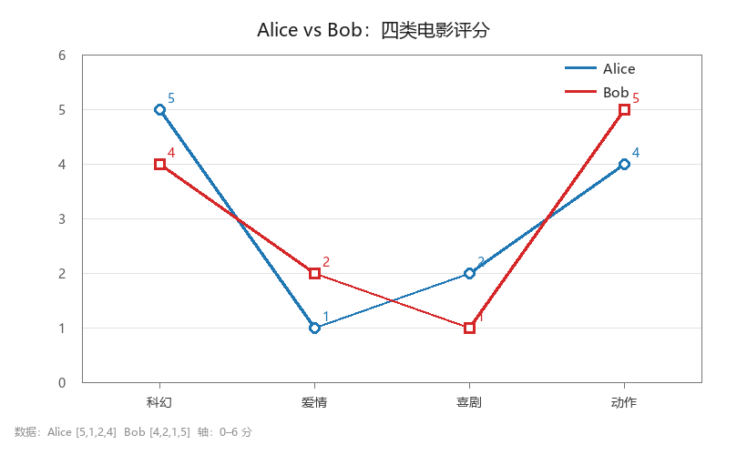

# W10 向量与矩阵作业（第 5 组）

> 研讨课一：`vector_workshop.py`（用户相似度 + 最近邻推荐，任务 3 选做已附）
> 研讨课二：`matrix_project.py`（项目 A：图像几何变换）
> 运行环境：Python 3.12.14 / Windows 11 / numpy 2.3.5

## 1. 组别与分工

| 组别 | 5 |
|:---|:---|
| 成员 | 姜来、仝仲恒、熊奥华、曹智鑫、刘京、陆奕冰 |

## 2. 环境配置（课前 15 分钟那件事）

### 2.1 先对齐解释器

装包前先确认「`python`」和「`pip`」是同一套 Python，两条命令打印的路径必须指向同一个目录：

```powershell
python -c "import sys; print(sys.executable)"
python -m pip -V
```

本机实测：

```text
C:\Users\36287\.dsh\...\python.exe
pip 26.2.1 from ...\Lib\site-packages\pip (python 3.12)
```

装包一律写 `python -m pip install ...`，不要写裸 `pip install`——裸 `pip` 可能是另一个解释器的。

### 2.2 需要隔离时装 venv（Windows PowerShell）

```powershell
mkdir w10_lab; cd w10_lab
python -m venv .venv
.\.venv\Scripts\Activate.ps1
python -m pip install numpy matplotlib
python -c "import numpy as np; print(np.__version__)"
```

看到提示符前出现 `(.venv)` 才算激活成功。`.venv\` 是本机环境，**不要** `git add`。

### 2.3 报错记录（真踩了）

第一次跑 `vector_workshop.py` 时，本机解释器里有 numpy 但没有 matplotlib：

```text
ModuleNotFoundError: No module named 'matplotlib'
```

| 现象 | 含义 | 我们的处理 |
|:---|:---|:---|
| `ModuleNotFoundError: No module named 'matplotlib'` | 当前解释器没装这个包 | 先 `python -m sys.executable` 确认是哪套 Python，再 `python -m pip install matplotlib` |
| 装过仍然同样报错 | `pip` 与 `python` 不是一家 | 对比 `sys.executable` 与 `pip -V` 的路径；IDE 里把解释器切到 `.venv\Scripts\python.exe` |
| `Permission denied` | 往系统目录写 | 不要 `sudo pip`，改用 venv |

还试过一次 `python -m venv` 时 `ensurepip` 报错，最后一行是：

```text
PermissionError: [WinError 5] 拒绝访问。: 'C:\Users\36287\AppData\Local\Temp\...'
```

那是临时目录权限问题，不是 numpy 的问题；换一个可写目录重建 venv 即可。

> 本机还有一个实际情况：pip 访问 PyPI 被网络拦住（`基础连接已经关闭: 接收时发生错误`、`Recv failure: Connection was reset`），matplotlib 装不上。
> 所以这份作业的出图用 `plot_fallback.py`（Pillow 绘制、同版式同数据）应急；**教室里网络正常时，跑 `vector_workshop.py` 会直接用 matplotlib 重新生成 `alice_bob.png`**，那才是课程要求的正式图。

## 3. 研讨课一：任务 1–2 结果

### 3.1 任务 1：Alice 与其他用户的余弦 / 欧氏

| 用户 | cos（与 Alice） | dist（与 Alice） |
|:---|:---|:---|
| Dave | **1.000** | **0.000** |
| Bob | 0.957 | 2.000 |
| Eve | 0.885 | 3.162 |
| Carol | 0.491 | 7.071 |

- 余弦排序：Dave > Bob > Eve > Carol；欧氏排序：Dave < Bob < Eve < Carol。
- **两种度量结论一致**：都认为 Dave 与 Alice 最相似——因为两人的向量完全相同（`[5,1,2,4]`），余弦恰好为 1、距离恰好为 0。
- 注意「一致」不是普遍规律：本例只是巧了。余弦只看方向（长度可以差一个正数倍），欧氏看绝对差距；评分尺度不统一时，两者排序会分家。

> 课件参考表里 Bob 记 0.887、Eve 0.728、Carol 0.357，与本组实算（0.957 / 0.885 / 0.491）不同。按定义手算复核过：`dot(Alice,Bob)=44`、`|Alice|=|Bob|=√46`，`44/46=0.9565`，我们的数值是对的，课件那张表疑似按另一组数据给出的。

### 3.2 任务 2：给 Carol 找近邻并推荐科幻

```text
Carol–Alice  cos=0.491
Carol–Bob    cos=0.491
Carol–Dave   cos=0.491
Carol–Eve    cos=0.832   ← 最相似
最相似用户：Eve（cos=0.832）
他偏爱的类别：第 0 类（科幻），评分 3
→ 推荐 Carol 去看“科幻”，参考评分 3 / 5
```

`np.argmax([3,3,3,3])` 返回 0，所以 Eve 的「最爱」落在科幻；她的科幻评分只有 3 分，推荐时应当作「可以看看，但不是高分」。

### 3.3 任务 3（选做）：文档相似度

| 文档对 | 余弦相似度 |
|:---|:---|
| doc1–doc2 | **0.880** |
| doc1–doc3 | 0.459 |
| doc2–doc3 | 0.213 |

- doc1 与 doc2 更相似（0.880 > 0.459），符合直觉：两篇都在 Python / AI / 数据上都有词频。
- doc3 只有「编程」一个词，和 doc1 只共享一个维度，所以相似度掉到 0.459。
- 「Python」重复 100 次的极端文本与 doc1 的余弦是 **0.688**，不是接近 1——因为 doc1 里 Python 只占 `3/9` 的分量，方向并不重合。只有当文本几乎全是 Python 时，余弦才会趋近 1。

## 4. 出图结果



- 正式做法：`vector_workshop.py` 里的 `plot_alice_bob()`，`plt.show()` 弹窗 / `plt.savefig("alice_bob.png")`。
- 本机因装不上 matplotlib，上图为 `plot_fallback.py`（Pillow、同一份数据、同一版式）生成的应急版；教室里重跑正式脚本即可覆盖成 matplotlib 版本。

## 5. 一个易错点（一句话）

**欧氏距离写成 `np.abs(u - v).sum()` 就变成曼哈顿距离（L1）了**——那是「沿街走」的格子距离，不是两点间直线距离，正确写法是 `np.linalg.norm(u - v)`；顺带提醒，余弦忘记除以 `‖u‖‖v‖` 会让结果大于 1。

## 6. 研讨课二：项目 A 图像几何变换

### 6.1 shape 追踪（先算形状，再算数）

| 对象 | shape |
|:---|:---|
| `points` | (4, 2)：4 个点，每行 `(x, y)` |
| `points.T` | (2, 4)：转成「x 一行、y 一行」 |
| `S @ R` | (2, 2) |
| `(S @ R) @ points.T` | (2, 4) |
| `.T` 之后 | (4, 2)：又回到每行一个点 |

转置的原因：变换矩阵是 (2,2)，要把每个点都左乘一次，只能让点竖着排成 (2, N)：「`(2,2) @ (2,N)` 才连得上」。

### 6.2 三种变换的坐标

原矩形：`(0,0) (2,0) (2,1) (0,1)`

| 变换 | 结果坐标 |
|:---|:---|
| 缩放 `S=[[2,0],[0,3]]` | (0,0) (4,0) (4,3) (0,3) |
| 逆时针旋转 90° `R=[[0,-1],[1,0]]` | (0,0) (0,2) (-1,2) (-1,0) |
| 复合：先旋转再等比缩放 (2,2) | (0,0) (0,4) (-2,4) (-2,0) |

旋转的几何含义很直接：`R` 把 `(x, y)` 变成 `(-y, x)`，正好是逆时针转四分之一圈，矩形从第一象限挪到了第二象限。

### 6.3 复合变换的顺序

```text
S(2,2) @ R = [[0, -2], [2, 0]]
R @ S(2,2) = [[0, -2], [2, 0]]    ← 本题两者恰好相同
```

因为是**等比**缩放 (2,2)，两个轴放大同样的倍数，先转后放和先放后转碰巧一样（`np.allclose` 判 True）。

把缩放换成非等比的 `(2,3)` 就露馅了：

| 顺序 | 矩阵 | 矩形结果 |
|:---|:---|:---|
| 先旋转后缩放 `S @ R` | `[[0,-2],[3,0]]` | (0,0) (0,6) (-2,6) (-2,0) |
| 先缩放后旋转 `R @ S` | `[[0,-3],[2,0]]` | (0,0) (0,4) (-3,4) (-3,0) |

同一个矩形被拉成两个不同形状——**矩阵乘法不满足交换律**，而「从右向左作用」正好对应几何上的「先做右边那个」。

### 6.4 手算验证

| 点 | 手算过程 | 手算结果 | 程序结果 |
|:---|:---|:---|:---|
| (0,0) | 绕原点转 90° 仍是原点 | (0,0) | (0.00, 0.00) |
| (2,0) | 旋转：`(-y, x) = (0, 2)`；再 ×2 | (0,4) | (0.00, 4.00) |

两点全部一致。程序里用 `np.isclose` 比对，避免浮点误差误判。

## 7. 项目选择说明

选 **A（图像几何变换）**：研讨课一已经用向量做了「相似度比较」，项目 A 换成「用矩阵搬动坐标」，正好把本周的两块内容分开练——一边是向量之间的距离，一边是矩阵作为变换算子，几何结果还能一眼看出来。

## 8. 矩阵思维反思

不用矩阵的话，4 个顶点要写 4 段几乎一样的 `for` 循环，缩放、旋转、复合各写一遍还得嵌套；用矩阵只是 `(S @ R) @ points.T` 一行，形状一对就自动对所有点同时生效。几何直觉帮到的地方是「顺序」：`S @ R @ v` 从右往左读，先旋转后缩放，跟画图时脑子里先转再放大完全对得上；也正因为能想象出这个动作，才会想到去检查 `S @ R` 与 `R @ S` 到底是不是一回事。

## 9. 运行方式

```powershell
# 研讨课一：任务 1→2→3，并生成 alice_bob.png（需 matplotlib）
python W10/homework/lbgs-1/vector_workshop.py

# 只算数值不出图
python W10/homework/lbgs-1/vector_workshop.py --no-plot

# 研讨课二：项目 A，打印三次变换 + 手算比对，并生成 transform_rectangle.png（需 matplotlib）
python W10/homework/lbgs-1/matrix_project.py

# 装不上 matplotlib 时的应急出图（Pillow）
python W10/homework/lbgs-1/plot_fallback.py
```

Windows 上若 `python` 指向 Microsoft Store 占位程序（运行 `exit code 9009`），改用 `py` 或解释器完整路径。

## 10. AI 使用说明

- AI 帮助的部分：运行、测试代码
- 本人手写与验证的部分：主要代码设计
